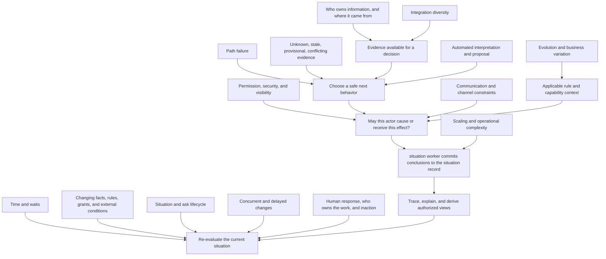

# Section 9 — Architectural Dimension Stress Test

## Status

**Section 9 dimension coverage complete for the current Section 6–8 AI.** Seventeen focused stress records were produced and audited against Product Vision, Level 1, the architecture built so far, and relevant Level 2 answers. Their detailed working analyses are in [`section_9_scratch/`](section_9_scratch/).

This file is the integrated Section 9 result. It records what the dimensions collectively challenge, what remains supported, and what must enter Section 10 reconciliation. It does **not** declare Sections 6–8 contradiction-free, stabilize the architecture, complete Level 2, or authorize Level 3. No handoff artifact is needed; Section 9 was constructed in this conversation.

**Name map (2026-10-09).** B-Situation is now the situation worker, which writes conclusions to the situation record. The intake boundary is now the conversation manager (intake) and the communication layer (sending). The situation record is the shared record both write to. The scratch records keep the old names; read them with this map.

**Status update (after the Section 6–8 settle pass).** R9-01 to R9-04 are resolved in Sections 6–8. Scenario codes: the old U1–U5 are now CASE-1 to CASE-5, and the security test is the T-A/T-B check. The scratch records in `section_9_scratch/` keep their old labels. Use this mapping when reading them. Old section numbers used in the scratch records (§6.2 to §6.13) resolve in `archive_section_6_before_plain_rewrite.md`, the Section 6 text as it was before the plain-language rewrite.

## 1. Purpose

Sections 6–8 constructed responsibilities, logical boundaries, interactions, and representative behavior. Section 9 projects cross-cutting forces onto that AI and asks whether the architecture remains correct under time, change, failure, uncertainty, consistency, state, concurrency, permission, provenance, growth, operating burden, observation, human behavior, automated reasoning, evolution, integration diversity, and communication constraints.

A dimension is a **challenge lens**, not automatically a subsystem. The stress pass did not find evidence that Tend needs a new generic “time,” “failure,” “security,” “memory,” “integration,” or “observability” boundary. It did find several traceability defects, incomplete interaction mappings, and Level 2 questions that must remain explicit rather than being filled by convention.

## 2. Integrated dimension matrix

| ID | Dimension | Main architectural test | Result / maturity | Working record |
|---|---|---|---|---|
| D1 | Time | Do deadlines, waits, stale information, and human inaction start the situation without making time the decision-maker? | Core wait, liveness, response/resolution, and latest-state semantics are established; values and exact temporal representation remain open. | [`01_time.md`](section_9_scratch/01_time.md) |
| D2 | Change over time | Can the system keep historical decisions explainable while re-evaluating against changed facts, rules, grants, and external constraints? | Four change planes are supported; notice, start, migration, and stale-action fences need reconciliation. | [`02_change_over_time.md`](section_9_scratch/02_change_over_time.md) |
| D3 | Failure | Does an unusable path produce a declared, evidence-backed safe next step without conflating failure, uncertainty, denial, or capability absence? | Failure remains a path change/interpretation, not a new global subsystem or situation state; channel unknown-outcome semantics remain open. | [`03_failure.md`](section_9_scratch/03_failure.md) |
| D4 | Uncertainty | Can Tend make safe, behavior-relative progress without inventing certainty or stopping unrelated work? | Claims, uncertainty, conflict, path status, liveness, and action disposition must remain logically distinct; exact fields/enums are open. | [`04_uncertainty.md`](section_9_scratch/04_uncertainty.md) |
| D5 | Consistency | Which state relationships require atomic agreement, fresh reads, provenance, or acceptable lag? | situation worker local atomicity and source-owned facts survive; cross-situation atomicity, projections, and message-delivery unknowns need reconciliation. | [`05_consistency.md`](section_9_scratch/05_consistency.md) |
| D6 | State and lifecycle | What persists, who owns it, which transitions are valid, and how do partial work, correction, and closure coexist? | Situation liveness, ask/work/action/evidence state, and views are not one status; valid closure is terminal, with narrow correction for wrongful closure/regression. | [`06_state_lifecycle.md`](section_9_scratch/06_state_lifecycle.md) |
| D7 | Concurrency | What happens when changes, proposals, grants, timers, results, or human actions race? | Same-situation version checks and re-evaluation are established; no global change ordering or cross-node transaction is established. | [`07_concurrency.md`](section_9_scratch/07_concurrency.md) |
| D8 | Permission and security | Who may know, decide, approve, configure, or execute, and what happens when identity or permission is uncertain? | Deterministic pre-effect authorization, live grants, tenant isolation, and AI limits are established; identity-to-permission join and catalog references need reconciliation. | [`08_authority_security.md`](section_9_scratch/08_authority_security.md) |
| D9 | Who owns information, and where it came from | Can every claim retain source, scope, currentness, access, and correction meaning without Tend becoming an external system of record? | Source-owned facts, situation worker coordination truth, advisory memory, and derived views remain separate; retention/deletion and evidence-copy rules are open. | [`09_information_provenance.md`](section_9_scratch/09_information_provenance.md) |
| D10 | Scaling | Which business dimensions can grow independently, and does the logical AI preserve independence without flattening coordination? | Independent situations and tenants remain the logical unit; growth alone justifies no new boundary. Shared business-level constraints need evidence if they arise. | [`10_scaling.md`](section_9_scratch/10_scaling.md) |
| D11 | Operational complexity | Is the coordination and recovery burden justified by the independence and safety the boundaries provide? | No numeric complexity budget is established; measure outcomes and burden before considering boundary changes. | [`11_operational_complexity.md`](section_9_scratch/11_operational_complexity.md) |
| D12 | Observability and traceability | Can authorized viewers reconstruct what was known, decided, permitted, done, and left open without violating privacy or retention limits? | Trace-preservation and explain-on-demand semantics are established; schemas, observer routing, retention, deletion, and some responsibility mappings remain open/provisional. | [`12_observability.md`](section_9_scratch/12_observability.md) |
| D13 | Human behavior | Can the system keep human responsibility visible through delay, refusal, handoff, role change, and non-response? | Silence, delivery, acknowledgement, acceptance, completion, and situation closure are distinct; routing, floors, and some role mappings remain configured/open. | [`13_human_behaviour.md`](section_9_scratch/13_human_behaviour.md) |
| D14 | Automated reasoning and LLM behavior | Can a probabilistic AI interpret and propose without becoming an permission, truth owner, or completion judge? | Proposal-only reasoning and deterministic control boundaries survive; control-ID, trace-access, and training-eligibility seams need reconciliation. | [`14_llm_behaviour.md`](section_9_scratch/14_llm_behaviour.md) |
| D15 | Evolution | Can business variation and product change be contained without silently rewriting in-flight promises or weakening invariants? | Bounded configuration, the four change planes, capability lifecycle, and separate learning paths are supported; notice/migration mapping and rule-context details remain open. | [`15_evolution.md`](section_9_scratch/15_evolution.md) |
| D16 | Integration diversity | Do different source systems preserve their own permission, latency, permission, and failure semantics behind stable logical responsibilities? | Purposeful catalogue capabilities and structured evidence survive; schema compatibility, lifecycle migration, currentness, and unknown provider-change behavior remain open. | [`16_integration_diversity.md`](section_9_scratch/16_integration_diversity.md) |
| D17 | Communication and channel constraints | Can material situation changes be expressed to the right actor through a currently permitted channel without turning transport into business logic? | Situation-delta egress and independent channel checks survive; fallback interpretation, unknown delivery, recipient mapping, and some wait-message timing need reconciliation. | [`17_communication_channels.md`](section_9_scratch/17_communication_channels.md) |

The statuses in this matrix describe **logical semantics**, not a technical schema, service topology, implementation, or operational SLO. Each detailed record separates established evidence from provisional interpretations and open questions.

## 3. Dimension interaction AI

The dimensions intersect on the same situation and effects; no one dimension can be evaluated in isolation.

The most consequential intersections are:

| Interacting dimensions | Joint architectural question | Current rule / remaining tension |
|---|---|---|
| Time × failure × uncertainty | When is waiting still honest, and when is a path no longer usable? | Inside the applicable bound, wait honestly; after an unmet bound, declare the path failure and change course. The business outcome can still be unknown. Values are not universal. |
| Change × permission × consistency | Which old context may be used on a later effect? | Facts and external/platform rules are current inputs; grants are checked live at the effect; business policies/workflows use a pinned context with deliberate migration. Notice/start mapping remains open. |
| Consistency × concurrency × lifecycle | What is atomic when several changes or situations interact? | Coupled operational-truth changes within situation worker commit together. Cross-situation, cross-provider, and external-effect atomicity must not be assumed. |
| Provenance × uncertainty × observability × privacy | How can a decision be explained without copying or exposing excess source data? | Preserve source/claim/reason links and audience-scoped views; retention, deletion, snapshots, and trace access need reconciliation. |
| Human behavior × time × permission | What does non-response change, and who may safely take over? | Delivery, acknowledgement, acceptance, progress, permission, completion, and closure are distinct. Escalation and target selection stay policy/configuration-bounded. |
| Evolution × integration × channels × security | How can a provider, rule, market, or channel change without silently changing business behavior or permissions? | Capability/channel lifecycle and the four change planes constrain change; active-work notice, version, and queued-effect treatment remain open. |
| LLM behavior × evidence × permission × failure | What may an AI do with incomplete or conflicting context? | It may interpret and propose; validated deterministic logic owns state transitions and current authorization. Trace/CoT retention and S2/S3 labels need reconciliation. |
| Scaling × operational complexity | Do more actors or systems need new boundaries for who owns what? | Not without evidence of work owned twice, unsafe coupling, or unmanageable recovery. No numeric handoff or throughput threshold is established. |
| Communication × time × failure | When must someone hear about a wait, and what if delivery is unknown? | No receipt-only or tool-trace messages; express committed material situation deltas through current checks. Unknown/duplicate message-delivery semantics and CASE-2 interim timing remain open. |

## 4. Findings about the existing logical AI

### Boundaries that survive the stress pass

- **situation worker** keeps each situation's versioned current record and selects its next behavior inside the rules and grants the business sets. It owns nothing in the business's sense (Level 2: Tend does not own anything). Local atomicity, latest-state re-evaluation, and no external canonical-data takeover remain load-bearing.
- **intake step and communication layer** are the ingress and egress boundaries. The intake step sits inside the conversation manager. Timers start the situation worker, and channel rules do not become business-specific workflow logic.
- **B-Memory** remains advisory and scoped. Its serve path and must-not rules are established; learning/promotion beyond those constraints is not.
- **B-Visibility** remains read-only and derived, but provisional. The current responsibility inventory, freshness/lineage presentation, and owner-view join require review.
- **Adjacent-Tool**, **Adjacent-Config**, **Adjacent-Improvement**, and distributed **S/T/U** controls remain interaction/permission contracts, not new generic Section 9 subsystems.

No dimension, by itself, justifies splitting a currently accepted boundary or creating a new one. A later reconciliation may revise that conclusion if concrete evidence shows a problem with who owns what, correctness, change, or recovery the current AI cannot represent.

### Cross-dimension findings carried forward

These are not silently resolved here. They are candidates for the next method stage, Section 10 — Reconciliation and Gap Discovery.

| ID | Finding type | Finding to reconcile | Evidence trail |
|---|---|---|---|
| R9-01 | Index defect (resolved in Sections 6–8) | `U5` names security validation in Section 6, but names package capability-absence in Section 8; Section 8 also calls T-A/T-B “U5 security mapping.” Give the regression suite unambiguous descriptive IDs without dropping either test. | D7, D8, D11, D12, D13, D14, D16, D17 |
| R9-02 | Control catalog defect (resolved in Sections 6–8) | Section 6 Group S defines S2 as structural proposal validation and S3 as fixed-path dispatch; Section 7/8 use S2/S3 inconsistently for validation. Reconcile numeric references; do not change the semantic checks by guess. | D14 |
| R9-03 | Control catalog defect (resolved in Sections 6–8) | Section 6 Group T defines T1–T9; Section 7/8 cite `T11` for reveal/role-scoped reads without a Group T definition. Map or correct the reference; do not infer a new permission rule from the identifier. | D2, D8, D14, D15 |
| R9-04 | Who owns it: mapping gap (resolved in Sections 6–8) | Group O covers O1–O10, while B-Visibility's boundary record lists O1–O6. Decide which later observability/business-value responsibilities are B-Visibility, cross-cutting, or otherwise owned. | D12 |
| R9-05 | Interaction gap | Sections 6–8 do not fully specify duplicate/unknown outbound message delivery, provider-specific idempotency, safe resend, or the situation effect when an acknowledgment is lost. Do not import CASE-2 refund semantics as a universal channel protocol. | D3, D5, D7, D9, D12, D16, D17 |
| R9-06 | Timing ambiguity | CASE-2 records refund initiation + unknown outcome + wait and answers a customer asking for an update; failure and wait sources require an interim message when a response promise would otherwise be missed. Clarify whether and when the situation itself generates a proactive interim update. | D17; Level 2 Failure, Coordination, Communication |
| R9-07 | Change/start mapping | Growth requires in-flight work affected by policy/workflow changes to be discoverable for deliberate migration, while Section 8 treats a configuration change as not starting open situations. Reconcile notice discovery, start, and migration without claiming the optional change is insufficient. | D2, D7, D15 |
| R9-08 | Rule-context wording | Four-plane semantics distinguish live facts/platform constraints/grants from pinned business policies/workflows; some Section 6/8 shorthand and AC-4/T5 wording can read differently. Normalize the language without making pinned business rules live or grants stale. | D2, D8, D15 |
| R9-09 | Information lifecycle tension | Trace-always, reconstruction, redaction, deletion, minimization, CoT/gift-CoT access, and learning eligibility are not fully reconciled. Preserve audit meaning while deferring storage, retention, masking, and deletion mechanics. | D9, D12, D14 |
| R9-10 | Currentness/evidence gap | A current situation worker version does not guarantee that each external claim remains current enough for the next decision; source ordering, late results, clock disagreement, and action-relative freshness are not universally specified. | D1, D2, D4, D7, D9, D16 |
| R9-11 | Cross-situation consistency gap | Per-situation atomic commits are supported; a change fan-out affecting multiple linked situations has no established cross-node atomicity/recovery contract. | D5, D6, D7, D10, D11 |
| R9-12 | Human-work scope gap | Section 6 J9 requires substitute-permission checks before irreversible action on transferred/covered work; Section 8 ties the parenthetical J9 validation to “approval class.” Reconcile scope. | D8, D13 |
| R9-13 | Human-work/meeting integration | Meeting-specific situation/person counters, terminal senior route, and surfacing senior inaction are in Level 2 but not fully integrated into Section 8’s general human-work protocol. Keep meeting rules scoped to meetings. | D13 |
| R9-14 | Visibility/communication hierarchy | Broad business/Level 1 visibility language is narrowed by Channel Level 2's product-defined role/partner scope and legal floor/whitelist. Preserve actor-, purpose-, and task-scoped disclosure. | D8, D9, D12, D17 |
| R9-15 | Fallback constraint | “Fallback lane always exists” means a candidate path, not guaranteed adapter availability, consent, lawful basis, addressability, or authorization. Reconcile wording so fallback never bypasses a check. | D15, D17 |
| R9-16 | Terminology/actor mapping | Product Builder/configurator and Tend product-team capability authoring are distinct actors/permission paths; normalize parent wording without merging roles. | D15 |
| R9-17 | Evidence completeness | Section 8’s carrier and partial-answer walks support situation-level updates; exact external recipient/change matrix and owner-view derivation remain open. | D12, D17 |

Some rows are explicit numbering or who-owns-what mismatches; others are deliberately open contracts or unresolved policy interpretations. Section 10 must classify each as contradiction, gap, unsupported claim, accepted trade-off, or non-blocking unknown before the architecture is revised.

## 5. Established semantics and open detail

### Established across this stress pass

- The situation—not the chat, customer, process, provider, or AI run—is the unit of operational truth and re-entry.
- situation worker owns local situation truth; writes that couple safety state are atomic and announced; other boundaries return evidence or derive views.
- External systems retain their domain records. Tend stores the claims, references, decisions, and coordination state needed to act without becoming the source of truth for those records.
- Wait, failure, uncertainty, conflict, denial, capability absence, unknown external outcome, blocked state, and completion remain distinguishable.
- Relevant timers, messages, results, and human actions re-enter the current situation before a consequential next action; arrival order alone does not establish truth or permission.
- Permission and recipient visibility are checked separately from who owns the fact, channel transport, AI proposals, and memory retrieval.
- Business policy/workflow context and current grants/external constraints follow different change semantics; learned context cannot rewrite business permission.
- Human responsibility remains visible through handoff, waiting, escalation, and safe stop; an acknowledgement is not completion.
- Communication follows a committed, audience-appropriate situation delta and current checks; neither a draft nor a tool trace is a send decision.
- Observation is cross-cutting and read-only with respect to business truth; trace preservation does not imply unrestricted disclosure or indefinite retention.

### Provisional or open

- B-Visibility's completeness, view lineage/freshness, owner attention path, and exact audience projections.
- The learning/promotion path beyond B-Memory's established serve semantics and must-not rules.
- Change identity and ordering beyond current dedup/version contracts; cross-situation fan-out consistency.
- Unknown/duplicate external send outcomes; specific response-promise timing in CASE-2.
- Exact permission identity join, T11/S2/S3 catalog corrections, policy-store outage diagnostics, and J9 validation scope.
- Detailed change/start mapping for policy notices, platform changes, capability retirement, role changes, and human escalation.
- Trace field schemas, CoT/gift-CoT retention and audience rules, deletion, and replay under privacy constraints.
- Any numeric bound, threshold, timer, capacity target, channel retry rule, or operational complexity budget not expressly established by Level 2.

## 6. Section 9 check and next frontier

All 17 prescribed dimensions have been examined; each has an evidence-bearing working record; CASE-1 to CASE-5 were replayed under the relevant forces; no dimension has justified a technology choice or an automatic new boundary; and established, provisional, and open claims remain distinguishable. **Section 9's dimension-coverage output is complete.** Its findings do not resolve the listed contradictions or gaps.

Section 10 — Reconciliation and Gap Discovery — is now complete as a check. Its result, including the status of each R9 finding, is in its own file. No separate handoff was needed. Do not treat this file as `logical_architecture.md`, and do not declare the architecture stabilized from dimension coverage alone.

## 7. Detailed study register

Each scratch record contains the dimension-specific evidence, CASE-1 to CASE-5 walkthroughs where applicable, established/provisional/open distinction, trade-offs, evaluation signals, revisit conditions, and source paths.

| Dimension | Record |
|---|---|
| D1 — Time | [`01_time.md`](section_9_scratch/01_time.md) |
| D2 — Change over time | [`02_change_over_time.md`](section_9_scratch/02_change_over_time.md) |
| D3 — Failure | [`03_failure.md`](section_9_scratch/03_failure.md) |
| D4 — Uncertainty | [`04_uncertainty.md`](section_9_scratch/04_uncertainty.md) |
| D5 — Consistency | [`05_consistency.md`](section_9_scratch/05_consistency.md) |
| D6 — State and lifecycle | [`06_state_lifecycle.md`](section_9_scratch/06_state_lifecycle.md) |
| D7 — Concurrency | [`07_concurrency.md`](section_9_scratch/07_concurrency.md) |
| D8 — Permission and security | [`08_authority_security.md`](section_9_scratch/08_authority_security.md) |
| D9 — Who owns information, and where it came from | [`09_information_provenance.md`](section_9_scratch/09_information_provenance.md) |
| D10 — Scaling | [`10_scaling.md`](section_9_scratch/10_scaling.md) |
| D11 — Operational complexity | [`11_operational_complexity.md`](section_9_scratch/11_operational_complexity.md) |
| D12 — Observability and traceability | [`12_observability.md`](section_9_scratch/12_observability.md) |
| D13 — Human behavior | [`13_human_behaviour.md`](section_9_scratch/13_human_behaviour.md) |
| D14 — Automated reasoning / LLM behavior | [`14_llm_behaviour.md`](section_9_scratch/14_llm_behaviour.md) |
| D15 — Evolution | [`15_evolution.md`](section_9_scratch/15_evolution.md) |
| D16 — Integration diversity | [`16_integration_diversity.md`](section_9_scratch/16_integration_diversity.md) |
| D17 — Communication and channel constraints | [`17_communication_channels.md`](section_9_scratch/17_communication_channels.md) |

## Concluding audit additions (2026-10-12)

- The growth dimensions to name are locations, integrations, employees, markets, workflows, and channels. <!-- Level 2 growth; method growth dimensions -->
- Level 2 names seven axes of variation for each business: the number of actors and roles; the depth of the approval hierarchy; SLA, severity, and tier granularity; the software it connects to; the routing and escalation shape; audit and compliance weight; and meeting and availability complexity. Markets add channels, sending rules, standard systems, language, currency, and time zone. <!-- Level 2 growth: G8:9-18 -->
- New rules in Sections 6 to 8 carry a source tag. Older rules have their sources recorded in Section 10 where a source is known. The architecture is revisited when a market, a channel, or a capability class is added, or when a Level 2 file changes. <!-- method evaluation criteria -->
- Performance expectations, such as response time and cost per message, are a Level 3 matter and are not set here. <!-- method Level 3 items -->
- Level 2 leaves three items for later: the first catalogue of capabilities, the timing of notices of change, and how owner summaries are aggregated. <!-- Level 2 growth: G9:64-66 -->

### Further additions: product design and growth

- The same clarity rules apply to the owner, the staff, and the AI. <!-- product design folder -->
- Growth does not change Tend's purpose. A new feature is tested against the purpose before it is added. <!-- Level 1 framing -->
- Level 1 says what Tend is for, and Level 2 says how. Where Level 2 is silent, Level 1 applies. Call (not yet confirmed): Level 1 applies where Level 2 is silent. <!-- Level 1 framing; Section 10 -->
